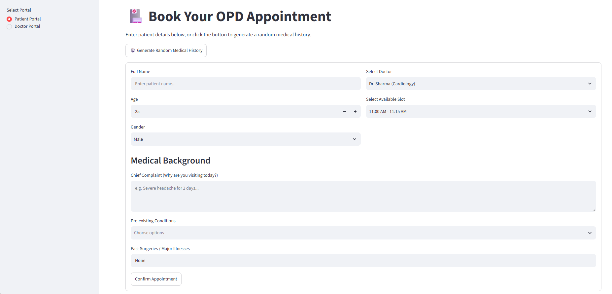

# Smart Appointment System for OPD and Medical sector #

## Inspiration✨: 

I got this idea because my father is a doctor and sometimes his OP appointments are overlapping with his surgeries, his free time, etc. Then later I also realized that most of the doctors and patients face this problem of not proper communication or coordination between the doctor and the patient. So, I have decided to make a system where there will be a proper coordinated communication between a doctor and the patient. I want to create an app where it a platform for the whole hospital or a department where the app would know the doctors' every day schedule but for now I made a small website using streamlit. When I have enough resources I will try to make and app for this.   

## Tech Stack⚒️:

**Python:** Like most of my projects this is built by using python as the main programming language as it is powerful tool, easy to spot errors, can be easily run through windows and it is cost effective

**Streamlit:** Of course for patients and doctors to interact with each other there should be a common platform where they can communicate or send information to each other.So, I used streamlit to do this task for now as it can be easliy run through python and make a good basic model for the website  

## Website Architecture🏛️:

In the website there are two portals one patient portal and other the doctor portal(in real application of this the people will have designated portal to them and they cannot view the other portal. This option of switching is only here for reference)

### **The Patient Portal:**
This is where the patient fills in all the details of their main problem, at what time can visit the doctor for OPD, etc 

<ins> **Main Components:** </ins>

**The Main details section:**  
This is the part where the patient enters their personal details like name, age, and gender. As well as the time they were able to visit and the doctor they are willing to visit (Note:The system already knows when the doctor is avilable for OP and only gives those timings ).

